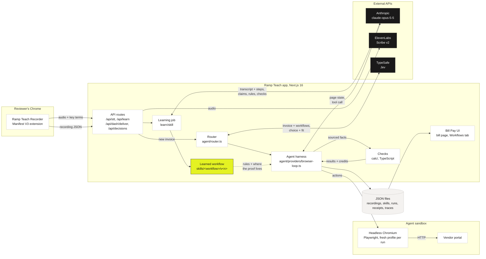
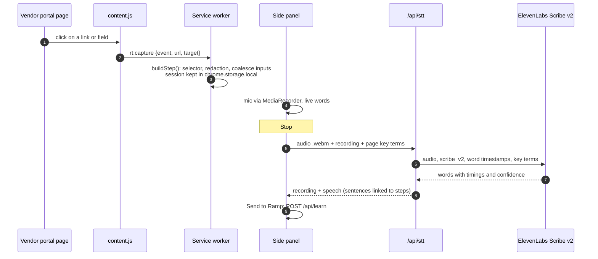
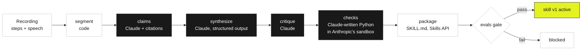
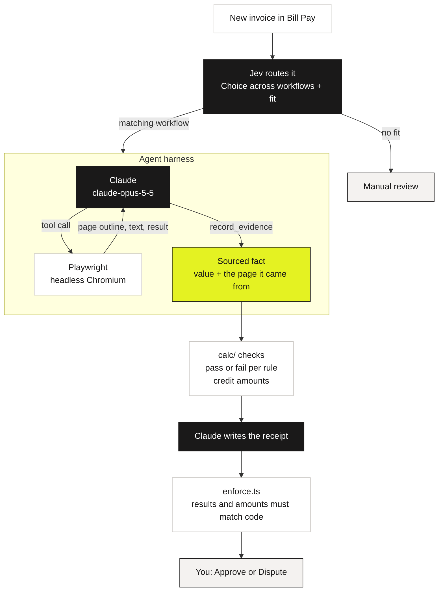
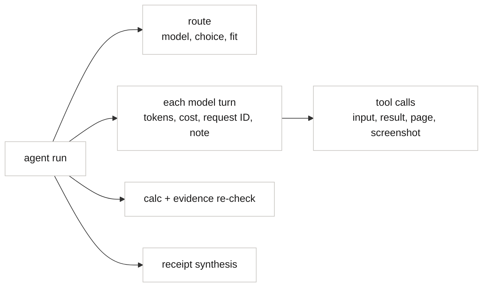

<p align="center">
  
</p>

<p align="center">
  <b>Show a review once. Ramp Teach turns it into a tested workflow, and the next invoice arrives with evidence.</b><br>
  <sub>Unofficial hackathon demo inspired by Ramp's design. Not affiliated with Ramp. All data is synthetic.</sub>
</p>

<p align="center">
  <a href="docs/TECHNICAL.md">How it works</a> &nbsp;&nbsp;
  <a href="docs/HANDOFF.md">Handoff</a> &nbsp;&nbsp;
  <a href="docs/ramp-teach-demo.mp4">Product demo</a>
</p>

---

## The problem

A staffing invoice lands in Bill Pay. Checking it means opening the contract for the rate card and the vendor's
portal for each person's approved timecard, line by line. Every AP team does this by hand, every week, and the
knowledge of *how* to check lives in one reviewer's head.

## What Ramp Teach does

1. **Record.** The reviewer checks one invoice in the vendor portal with the Ramp Teach Recorder (a Chrome extension)
   open, narrating as they go. It captures what they click and what they say, not a video.
2. **Learn.** Claude turns the recording into a versioned workflow: the rules, each cited to the words and click it
   came from, and where the proof lives. Evals decide whether the version goes live.
3. **Review.** A new invoice arrives. A decision model picks the matching workflow, and its agent opens the portal in
   its own sandboxed browser, records each fact with its source, and code checks the numbers. Claude writes the
   receipt. A person approves or disputes.

---

## System at a glance



The learned workflow is the only thing that crosses from teaching to review. No video, audio or browser session
crosses.

---

## 1. Recording and Transcription

The recorder captures **events and words**. Each click is stored with the exact element it hit; each sentence the
reviewer says is stored with word timing and linked to the clicks around it. The click locates the evidence; the
sentence explains the rule.



What a recorded moment looks like:

| kind | detail |
|---|---|
| click | `a[href="/portal/employees/<employee_id>?week=<date>"]` "View timecard" |
| click | `[data-field="approved_hours"]` with the value shown on the page |
| say | "Billed hours can't go over the approved hours." linked to the click above |
| type | `input[name="password"]` `[redacted]` |

- **Element identity:** `[data-field]`, then `tag[name]`, `#id`, `a[href]`, then a short CSS path.
- **Privacy:** passwords are redacted in the page and again in the worker, before anything is sent.
- **Speech:** ElevenLabs Scribe v2 with page-aware key terms (names, IDs, field labels seen on the recorded pages),
  aligned to clicks in `src/lib/speech/align.ts`.

---

## 2. Agent Learning

"Learn" means Claude writes a **versioned workflow (an Agent Skill)** from the recording. Every rule is cited, the
version is tested, and only then does it go live.



How one rule is learned:

| Recording | Claim (cited) | Learned rule | Where the proof lives |
|---|---|---|---|
| a click on the timecard's approved-hours field, and the sentence "Billed hours can't go over that." | the quoted words, cited to the sentence and the click | Billed hours on each labor line must not exceed the approved hours on that employee's timecard for the same week. | the timecard page pattern and its `approved_hours` field |

| Learned from the recording | Written by engineers |
|---|---|
| rules, where the proof lives, vendor, open questions, citations | the six checks in `src/calc/` (TypeScript), the evidence tasks, receipt enforcement, guardrails |

**Skill evals** (`npm run eval:skill`): 8 recording variants with known answers (baseline, paraphrase, reordered,
shown not said, said not shown, filler, a skipped step, speech-to-text noise), graded for rule recall and
precision, citation validity, coverage of pages and fields, replay against past invoices, consistency and voice
accuracy. The gate requires 100% recall, precision, citations and replay, and 90% coverage.

---

## 3. Agent execution and evaluation



- **Sees a page** as an outline where each usable element gets a `data-agent-ref`, so it acts by reference, not by
  pixel. Tools: `browser_toolset_20260801` (navigate, click, form input, find, read page, page text, wait) plus
  `record_evidence` and `sign_in`.
- **Signs in from a vault:** the harness fills the portal login; the model never sees the password.
- **Guardrails:** localhost portal only (checked in the toolset and the driver), no scripts, no uploads, 25-turn cap,
  task budget. The agent never approves, pays or attaches.
- **Output:** a receipt with each check, its source and the credit to request, recommending approve or dispute.

### How we know it's right

| Layer | What it tests | How | Result |
|---|---|---|---|
| Checks | The six checks in `src/calc/` | Replay past corrections and past invoices (`npm run eval`) | each correction caught, clean invoices pass |
| Learning | Did it learn the right workflow? | 8 recording variants, graders, gate (`npm run eval:skill`) | gate decides the active version |
| End to end | The whole review | Live review runs against the expected outcome (`npm run demo`) | recommendation and decision flow as expected |

---

## Observability



| What | Where |
|---|---|
| Spans for every model turn and tool call | `runs/<invoice>/spans.jsonl` (run page waterfall in Workflows → Runs) |
| Routing decision | `runs/<invoice>/route.json` |
| Live view of the agent's browser | `runs/<invoice>/live/` (shown inside the bill page) |
| Every fact re-read from its page by code | `runs/<invoice>/evidence-check.json` |
| Learning stages with request IDs | `skills/<id>/v<n>/stages/` |
| Every Claude call with tokens and Anthropic request ID | `runtime/usage.jsonl` (`npx tsx scripts/usage.ts`) |

---

## Quick start

```bash
npm install && npm run setup
```

`npm run setup` checks Chromium, ffmpeg, fonts and your keys, runs the tests and lists anything you still need to do
by hand. Keys: `RAMP_ANTHROPIC_API_KEY` (required for live runs), `TYPESAFE_API_KEY` (Jev routing),
`ELEVENLABS_API_KEY` (speech). Without keys everything runs in offline mode.

```bash
npm run build && npm run start
```

Open http://localhost:3000/bills. Bill Pay, the Workflows tab and the vendor portal (`/portal/login`) are all in
the app.

| Command | What it does |
|---|---|
| `npm run skill:learn -- --recording <file>` | Learn a workflow version from a recording |
| `npm run eval:skill -- --yes` | Skill evals and the promotion gate (prints a cost estimate first) |
| `npm run eval` | Replay past corrections through the checks |
| `npm run agent -- <invoice_id>` | Route and review one invoice (app must be running) |
| `npm run demo` | End-to-end check of one review, including the UI decision |

## Stack

| | |
|---|---|
| App | Next.js 16 App Router, React 19, TypeScript, Tailwind v4, Zod 4, JSON files |
| Recorder | Chrome extension, Manifest V3 (content script, service worker, side panel) |
| AI | Anthropic `claude-opus-5-5` via `@anthropic-ai/sdk`: browser toolset, citations, structured outputs, code execution, Files API, Skills API |
| Speech | ElevenLabs Scribe v2 and Scribe v2 Realtime |
| Routing | TypeSafe Jev (System One) |
| Agent browser | Playwright 1.63, headless Chromium |
| Tests | Vitest, skill evals, correction replay |

## Repo map

```
src/          the app and engine
  app/          Bill Pay UI, API routes, fixture vendor portal (Next.js App Router)
  components/   UI components
  agent/        router, harness, browser driver, evidence re-check, receipt enforcement
  learn/        the learner (recording to workflow and skill versions)
  calc/         the six checks (plain code, no LLM)
  workflows/    workflow definitions (invoice review)
  contracts/    Zod schemas and engine interfaces shared by everything
  config/       engine and provider config
  lib/          storage, speech, skills, evals and shared helpers
extension/    the Chrome recorder (Manifest V3)
evals/        skill eval cases, recordings and harness
data/         seed data (read-only at runtime)
rules/  skills/  receipts/  runs/   learned rules, skill versions, receipts, per-run artifacts
samples/      sample receipt, invoice and calc report
scripts/      setup, end-to-end check, artifact guard
docs/         technical deep dive, handoff, design notes, build board, product demo video
```
