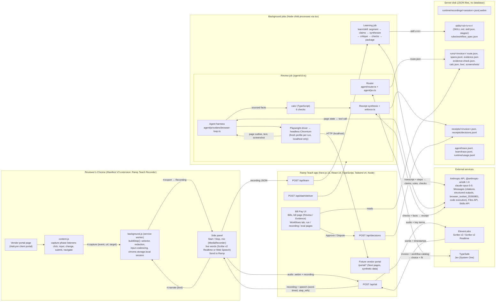

# Ramp Teach film: technical storyboard and visualization plan

Planning document for the next cut. It explains the system once (section 1), decides how architecture shows up in
the video (section 2), gives the edit order (section 3), and then storyboards the intro, the three technical
sections and the close (sections 4 to 9). Section 10 lists every on-screen claim with what backs it; section 11 is
what to do before rendering.

**Branches and artifacts this plan is built from**

| Name in this doc | Where | What it is |
|---|---|---|
| **Film take** | `main` @ `b5c7d9e` (also `claude/product-film-handoff-bwdohs`), `demo/video/film-run/*`, `demo/video/ramp-teach-film.mp4` (192.4 s) | The current cut: a real take with live Claude calls (1 learn, 2 reviews, 19 requests, $0.36). Old flow: sign-in, single-call learner, agent window overlay. |
| **Implementation** | `claude/pensive-turing-jh6orb` (this branch) | The new build: voice (ElevenLabs), six-stage skill learner (citations, code execution, Skills API), skill evals + gate, Jev routing, spans, live view, evidence re-check, the Bill Pay bill page and Workflows tab. 385 tests pass; verified end to end offline in the built app; no live take yet. |
| **Re-cut script** | `demo/video/film.ts` on this branch | Take sequence for the new flow: no sign-in, Workflows learning card, rules and recording pages, skill evals, routing card, run link, live view inside the bill page, run page, Evidence tab. Offline rehearsal completes (193.1 s). |

Evidence tags used below: **[take]** shown by the film take's artifacts, **[impl]** implemented on this branch
(tests and an offline run), **[take-next]** needs the next real take to produce the artifact, **[build]** small
build item recommended before rendering, **[next step]** future, not in the repo.

The next take keeps every Anthropic call live (learning, browser agent, receipt, eval judge). Jev routing and the
ElevenLabs transcript may come from their demo paths in the take; the screens look the same.

---

## 1. Full architecture

### 1.1 What runs where



### 1.2 The two paths, and where they meet

```
TEACHING PATH                                                      REVIEW PATH
Reviewer works in the portal and narrates                          New invoice lands in the Bill Pay inbox
  │ clicks, fields, pages (content.js)                               │ POST /api/dash/deliver
  │ words with timing (side panel → /api/stt → Scribe v2)            ▼
  ▼                                                                Router: Jev picks the workflow (or manual review)
Recording JSON  ── POST /api/learn ──►  Learning job (Claude)          │ route.json
                                          │                            ▼
                                          ▼                         Agent harness + Claude + browser tools
                               ┌──────────────────────────┐          │ fresh headless Chromium, signs in, reads timecards
                               │  LEARNED WORKFLOW        │──────────►│ sourced facts (record_evidence)
                               │  skill v1: rules +       │          ▼
                               │  where the proof lives   │        calc/ checks (TypeScript) → Claude receipt → enforcement
                               └──────────────────────────┘          ▼
                                                                    Reviewer: Approve / Dispute (POST /api/decisions)
```

The learned workflow is the only thing that crosses from teaching to review. No video, audio or browser session
crosses.

### 1.3 Boundary table (what moves across each arrow)

| From → to | What moves | Real name | Why the boundary exists | Status |
|---|---|---|---|---|
| Page → content.js | DOM event + element description (tag, `id`/`name`/`data-field`/`href`/`aria-label`, text, nth, 6 ancestors) | `describe()` in `extension/content.js` | Content scripts see the page; they can't keep state across navigations | [take] |
| content.js → service worker | `rt:capture {event, url, title, target, value}` | `chrome.runtime.sendMessage` | The worker owns the session in `chrome.storage.local`, so recording survives page loads | [take] |
| Side panel → worker | `rt:narrate {text}` (stamped with the current page) | `buildNarrationStep()` | Speech is captured in the panel, joined to the same timeline | [take] |
| Side panel → `/api/stt` → ElevenLabs | audio `.webm` + key terms → words with start/end/confidence | `lib/speech/elevenlabs.ts` (`scribe_v2`, `timestamps_granularity=word`) | The ElevenLabs key stays on the server | [impl] |
| Side panel → `/api/learn` | `{recording, operator}` (`RecordingSchema`: steps, transcript, speech) | `lib/learnjob.ts` saves `runtime/recordings/<session>.json` | The extension hands off; learning runs server-side | [take] (speech field: [impl]) |
| Learning job ↔ Anthropic | transcript + step list (citations), then structured calls | `learn/skill/*` (`claims.ts`, `synthesize.ts`, `critique.ts`, `checks.ts`, `package.ts`) | Model calls only in the job; output re-validated with Zod | [impl]; film take used the single-call `learn/distill.ts` [take] |
| Learning job → disk | `SkillVersion` + `SKILL.md` + `checks/*.py`; `rules/workflow_spec.json` synced from the active version | `lib/skills/compat.ts` | The review path reads a file, not the recording | [impl] / [take] for `workflow_spec.json` |
| Router ↔ TypeSafe | invoice + workflow catalog → Choice (probability per workflow) + Noul (fit) | `agent/jev.ts`, `POST api.typesafe.ai/v1/systemone` | Fast typed decision before any agent runs | [impl] |
| Harness ↔ Anthropic | page state, tool results → next tool call | `client.beta.messages.stream`, `browser_toolset_20260801` + `record_evidence` | The model decides; the harness executes | [take] (streaming + notes + budget: [impl]) |
| Harness → Playwright → portal | `navigate`, `left_click`, `form_input`, `find`, `read_page`, `get_page_text`, `wait` | `agent/browser/playwright-driver.ts` | Real browser actions, URL policy enforced twice | [take] |
| Harness → calc | facts with sources (`fixture:/portal/employees/E-104?week=2026-10-18`) | `runs/<id>/evidence.json` | Arithmetic and pass/fail never go through a model | [take] |
| Synthesis ↔ Anthropic | calc results + facts + learned spec → receipt (structured) | `synthesisPrompt()` in `agent/engine.ts` | Claude writes the explanation; `enforce.ts` overrides any check that disagrees with calc | [take] |
| UI → `/api/decisions` | Approve / Dispute | `receipts/decisions.jsonl` | Only a person decides | [take] |

### 1.4 Stack, by job

| Piece | Technology | Its job |
|---|---|---|
| Recorder | Chrome extension, Manifest V3 (content script, service worker, side panel) | Capture clicks, fields, pages and speech on the vendor portal |
| Speech | ElevenLabs Scribe v2 (batch, word timestamps, key terms); Scribe v2 Realtime (live preview); Web Speech API fallback | Words with timing, aligned to clicks (`lib/speech/align.ts`) |
| App | Next.js 16 App Router, React 19, TypeScript 5.9, Tailwind v4, Zod 4 | Bill Pay UI, API routes, the fixture vendor portal, job launcher |
| Learning | `@anthropic-ai/sdk` 1.6, `claude-opus-5-5`: citations, structured outputs, code execution (`code_execution_20260521`), Files API, Skills API | Turn a recording into a versioned, cited skill |
| Routing | TypeSafe Jev (System One: Choice + Noul) | Pick the workflow for a new invoice |
| Agent | Anthropic `browser_toolset_20260801` served by Playwright 1.63 driving headless Chromium; custom `record_evidence` tool | Gather facts from the portal |
| Checks | TypeScript (`calc/`) | Six checks: line math, total, contract rate, duplicates, allowed charges, hours vs timecards |
| Storage | JSON files on the server's disk | Recordings, skills, runs, receipts, traces, usage |
| Tests | Vitest (385 tests), `npm run eval` (correction replay), `npm run eval:skill` (skill evals) | |
| Not in the stack | OpenAI, any computer-use API, a database, a real Ramp account, a real vendor | |

### 1.5 Product runtime vs film production (keep visually separate)

```
PRODUCT RUNTIME (what the diagrams show)          FILM PRODUCTION (never drawn as a product dependency)
Recorder extension in Chrome                      Stage page public/stage/index.html: macOS wallpaper, Chrome frame,
Next.js app + API routes + jobs                     the real app in an iframe, the real extension files served by
Playwright driving the AGENT's Chromium             app/stage-ext with public/stage/chrome-shim.js for chrome.* APIs
Anthropic / ElevenLabs / TypeSafe APIs            Playwright driving the REVIEWER's cursor and clicks (demo/video/film.ts)
JSON storage                                      Narration lines fed to the real side panel (demo voice path)
                                                  ffmpeg compositing, caption PNGs, diagrams.ts renderer
```

Playwright appears on both sides for different jobs: in the product it is the agent's browser driver; in the
film it plays the reviewer.

**Real vs synthetic (for us):** no real Ramp account (the Bill Pay screens are this app's own Ramp-style pages
with synthetic data); no real vendor (the Halcyon portal is a fixture inside the app); Anthropic calls are live.

---

## 2. Does the video need a standalone architecture diagram?

### 2.1 What the three feature sections already answer

| Architecture question | Answered by | Where in the edit |
|---|---|---|
| What does the recorder capture, and in what form? | Recording and Transcription: trace rows + payload | T1 |
| Where does speech go and how does it join the clicks? | Recording and Transcription: speech lane + aligned rows | T1 |
| What leaves the reviewer's browser? | T1 final frame: one recording JSON → `POST /api/learn` | T1 |
| What does Claude do with the recording, and what is stored? | Agent Learning: input → claim → rule → skill v1 | T2 |
| How does the learned workflow reach execution? | Agent Learning downstream beat + Agent execution inputs | T2 → T3a |
| How does the agent see and act on a page? | Agent execution loop | T3a |
| Where do checks and the receipt sit relative to the model? | Agent execution: after-loop lane | T3a |
| How do we know it's right? | Agent execution and evaluation: eval layers | T3b |

### 2.2 What is still hard to piece together

1. **That there are two separate browsers.** The film shows the reviewer's Chrome and, later, the agent's browser
   inside the bill page. Viewers will assume the agent reuses the reviewer's browser, cookies or login. It doesn't:
   it runs its own fresh, sandboxed Chromium and signs in itself.
2. **What crosses from teaching to review.** Without one picture, "it watched me" reads as "it learned from a
   screen recording". Only the learned workflow crosses.
3. **Where Claude is called vs where code runs.** Claude appears in three jobs (learning, browsing, writing the
   receipt). Each feature section shows one; the pattern (model decides, code checks, person approves) only reads
   when the jobs sit side by side.

### 2.3 Recommendation

**A short standalone overview (about 8 s) right after Send to Ramp, plus a recurring mini-map** in the top-right
corner of each feature section that lights up the part being explained.

- **Why there:** the viewer has just watched something leave the extension. "Where did it go?" is the natural
  question, and the answer (two paths meeting at the learned workflow) frames everything after it.
- **Why not more:** the overview shows only groups and three labeled arrows. Component detail stays in the feature
  sections, so it costs 8 seconds, not 30.
- **The mini-map** closes gap 3 without new screen time: the same four groups (Reviewer's Chrome, Ramp Teach app ,
  Agent sandbox, Anthropic) sit small in the corner, and the active one turns lemon.
- The full diagram (1.1) stays in this document.

---

## 3. Recommended order of the finished video

Built on the re-cut take sequence in `demo/video/film.ts` (this branch). Its offline rehearsal runs 193.1 s
(`demo/video/work-film/rehearsal.mp4`); "rehearsal time" below is where each moment lands in it. Two beats are new
(intro, architecture overview) and the four technical sections replace the rehearsal's four diagram slots
(`slotsFor()`: `voice`, `skill`, `execution`, `trace`).

| # | Beat | Type | Length | Anchor (take mark) | Rehearsal time |
|---|---|---|---|---|---|
| 0 | Intro: Ramp Teach logo + the problem | New card | 6 s | before `start` | new |
| 1 | Reviewer records the HSG-1010 review; Stop shows the word-timed transcript with step links | Footage | 34 s | `start` → `record_stop` | 0 to 38 s |
| 2 | **Recording and Transcription** | Cutaway (slot `voice`) | 16 s | `record_end` | 40.7 s |
| 3 | Send to Ramp, lands in Bill Pay → Workflows | Footage | 4 s | Send | after slot |
| 4 | **Architecture overview** | Cutaway (new slot `overview`) | 8 s | `learn_start` | new |
| 5 | Six learning stages live, v1, Rules tab (rule opened), recording page | Footage | 20 s | `learn_start` → `recording` | about 46 to 74 s |
| 6 | **Agent Learning** | Cutaway (slot `skill`, covers the cut eval run) | 18 s | `eval_start` to `eval_end` | 75.7 s |
| 7 | Evals tab with the gate, v1 active, For approval | Footage | 6 s | `eval_end` | after slot |
| 8 | HSG-1011 bill page: routing card, run link, live view of the agent, run page waterfall, Evidence tab, Dispute | Footage | 40 s | `deliver_1011` → `dispute` | about 96 to 136 s |
| 9 | **Agent execution and evaluation, beat 1: the run** | Cutaway (slot `execution`) | 22 s | `dispute + 2.8` | 138.0 s |
| 10 | HSG-1012 clean review, Approve, Payment required | Footage | 14 s | `deliver_1012` → `end` | about 160 to 175 s |
| 11 | **Agent execution and evaluation, beat 2: evals, trace, cost** | Cutaway (slot `trace`) | 20 s | `end - 2.9` | 175.6 s |
| 12 | Close: what this proves + one next step | Card | 7 s | before the outro | new |
| 13 | Outro (logo) | Existing | 4 s | end | end |

Total about 3 min 40 s.

Because the re-cut footage now shows the run page, Evidence tab, Evals tab and recording page, the technical
sections explain those screens instead of introducing them. T2's evals mention stays brief (the footage after it
shows the gate); T3b carries the full eval explanation.

## 4. Intro (beat 0)

**Viewer knows:** Ramp, Bill Pay. **Viewer needs:** what manual work sits around a bill, and what we built.

**Frame (6 s):** dark background, Ramp Teach lockup (Ramp mark + "Teach"), one line under it. After 2 s the line
gives way to a three-step strip:

```
  ramp ⟋ | Teach

  A staffing invoice lands in Bill Pay. The proof is in a contract and a vendor portal.

  [ Reviewer shows the check once ]  →  [ Ramp learns the workflow ]  →  [ Next invoice arrives with evidence ]
```

- On screen: exactly the lines above.
- VO: "A staffing invoice lands in Bill Pay, but the facts to check it live in a contract and a vendor portal. Ramp
  Teach lets a reviewer show that check once, so the next invoice arrives with the evidence and a recommendation."
- Motion: lockup fades in; strip steps light up left to right; cut to the browser.

---

## 5. Recording and Transcription (beat 2)

**Viewer just saw:** the reviewer opening invoice HSG-1010, clicking View timecard, narrating, Stop.
**Viewer should leave knowing:** the recorder captures **events and words, not video**; each click is stored with
the exact element; speech arrives with word timing and is linked to the clicks it talks about; passwords never
leave the page; one JSON payload goes to Ramp.

**Placement:** full-frame cutaway replacing D1, right after Stop and before Send to Ramp. Mini-map: Reviewer's
Chrome lit.

**Frame layout (16 s), three columns:**

```
┌ Recording and Transcription ─────────────────────────────────────────────────────── [mini-map: Chrome lit] ┐
│                                                                                                              │
│  PORTAL EXCERPT (real screenshot)      WHAT THE EXTENSION RECORDED                 ONE RECORDING → RAMP       │
│  ┌──────────────────────────────┐     ┌───────────────────────────────────────┐  ┌──────────────────────┐   │
│  │ Invoice HSG-1010             │     │ 0:12 click  a[href="/portal/employees/│  │ POST /api/learn      │   │
│  │ Maya Chen   40 h  [View timecard]──►│      E-101?week=2026-10-11"]          │  │ {                    │   │
│  │                              │     │      "View timecard"                  │  │  session_id,         │   │
│  │ Timecard, Approved hours 40 ─────►│ 0:14 click  [data-field="approved_    │  │  steps: 25,          │   │
│  └──────────────────────────────┘     │      hours"]  "40"                    │  │  speech: 7 sentences │   │
│                                        │ 0:14 say   "Maya is approved for 40   │  │ }                    │   │
│  content.js ──► service worker        │      hours. Billed hours can't go     │  └──────────────────────┘   │
│  (capture phase)  (chrome.storage)    │      over that."  ◄─ linked to #16    │                             │
│  mic ──► /api/stt ──► Scribe v2       │ 0:05 type  input[name="password"]     │   Not sent: video, the     │
│          words + timings              │      [redacted]                       │   screen, cookies          │
└──────────────────────────────────────────────────────────────────────────────────────────────────────────────┘
```

- **Eye goes first** to the highlighted View timecard link, then its row appears.
- **Animation (in order):**
  1. Portal excerpt rises; the View timecard link gets a lemon outline; the click row slides in.
  2. Approved hours field outlined; its row slides in.
  3. The narration row appears word by word (word timings), and a thin line links it to row #16.
  4. The password row appears with `[redacted]`.
  5. The three rows drop into the payload card, and "POST /api/learn" lights.
- **Bottom-left caption strip** names the capture path: `content.js → service worker (chrome.storage.local) ,
  mic → /api/stt → ElevenLabs Scribe v2`.
- **Final frame:** the payload card with "Not sent: video, the screen, cookies".

**On-screen copy:** column headers above; row text as in the take. **VO (two sentences):**
"The recorder saves each click with the exact element it hit, and every sentence I say with its timing, linked to
the clicks around it. The click shows where the evidence is; the sentence says what rule I'm applying."

**Producer notes (not on screen):**
- Element identity: selector priority `[data-field]` → `tag[name]` → `#id` → `a[href]` → short CSS path
  (`selectorFor()` in `extension/lib/recording.js`); clicks are promoted to the nearest interactive/`data-field`
  ancestor (`pickTarget()`); text inputs are coalesced into one step per field (`appendStep()`).
- Redaction happens twice: in the page (`content.js`, `type=password` → `[redacted]`) and in the worker
  (`isSensitiveField()`: password, token, otp, ssn names).
- Survives navigation: the session lives in `chrome.storage.local`; client-side route changes are caught by URL
  polling (400 ms) and `popstate`/`pageshow`.
- Speech ↔ click link: `lib/speech/align.ts` links a sentence to steps from 6 s before to 1.5 s after it that share
  a token (numbers, IDs, names, element text, field name, URL), else the nearest click.
- The MP4 the viewer is watching is a separate film capture; the product never records video.

**Artifacts:** rows 14, 16, 17 of `demo/video/film-run/sent-recording.json` on `main`
(`a[href="/portal/employees/E-101?week=2026-10-11"]` "View timecard" at 03:23:31.795; `[data-field="approved_hours"]`
"40" at 03:23:33.136; narration at 03:23:33.155). Session `rec_20261111T032319Z_ixfg`, 25 steps, 7 narration
lines. [take]. Word timings and `step_refs` come from the next take's recording (`speech.utterances`) [take-next];
the shape is [impl] (`SpeechTranscript` in `contracts/pillars.ts`).

**After the implementation lands:** replace the narration row's timing with `speech.utterances[*].words` from the
new take; confirm `step_refs` links sentence "Maya is approved for 40 hours…" to the approved-hours click; screenshot
the real side panel's transcript (step chips) as an optional inset.

---

## 6. Architecture overview (beat 4)

**Viewer just saw:** Send to Ramp, then Bill Pay → Workflows. **Viewer should leave knowing:** two paths, one shared
learned workflow; the agent has its own sandboxed browser; Claude is called in three places, code checks, a person
decides.

**Frame (8 s):**

```
┌ How Ramp Teach fits together ─────────────────────────────────────────────────────────────────────────────┐
│                                                                                                             │
│  REVIEWER'S CHROME            RAMP TEACH APP (Next.js)                 ANTHROPIC                            │
│  ┌─────────────────┐  recording   ┌──────────────────┐   transcript +  ┌──────────────┐                     │
│  │ Recorder         │── JSON ────►│ Learning job      │◄── steps ─────►│ Claude       │                     │
│  │ extension        │             └────────┬─────────┘                 │ claude-opus- │                     │
│  └─────────────────┘                       ▼                           │ 5-5          │                     │
│                                ┌─────────────────────┐                 └──────▲───────┘                     │
│                                │ LEARNED WORKFLOW v1 │                        │ page state ↔ tool call      │
│  BILL PAY                      └──────────┬──────────┘                        │                             │
│  ┌─────────────────┐  new invoice ┌───────▼──────────┐   AGENT SANDBOX ┌──────┴────────────────────┐        │
│  │ Inbox            │────────────►│ Router (Jev)      │──────────────►  │ Agent harness, headless   │        │
│  └─────────────────┘             └──────────────────┘                 │ Chromium, fresh profile   │        │
│                                       receipt + evidence ◄────────────│ signs in from the vault    │        │
│  ┌─────────────────┐                                                   └───────────────────────────┘        │
│  │ You: Approve /   │◄─ receipt + evidence                                                                   │
│  │ Dispute          │                                                                                        │
│  └─────────────────┘                                                                                         │
└─────────────────────────────────────────────────────────────────────────────────────────────────────────────┘
```

- **Motion:** the teaching row draws left to right (0 to 3 s), the learned workflow box lands center and pulses
  once; the review row draws (3 to 7 s); the four group labels shrink into the corner mini-map (7 to 8 s).
- **On-screen labels only** (as above). Small tags: "Agent sandbox, fresh profile per run" and "signs in from the
  vault" on the agent group.
- **VO:** "What I recorded becomes a workflow. When a new invoice arrives, an agent runs that workflow in its own
  browser and brings back evidence."

**Backing:** 1.1 and 1.3. Agent sandbox: Playwright `chromium.launch()` + `newContext()` per run, request routing
to localhost only (`agent/browser/playwright-driver.ts`) [take]. Vault: [build] (section 11, item 2).

---

## 7. Agent Learning (beat 6)

**Viewer just saw:** the Workflows tab learning stage by stage, then the rules. **Viewer should leave knowing:**
"learn" means Claude writes a **versioned workflow spec (skill)** from the recording, with every rule cited to the
words and clicks it came from; it is checked before it goes live; the agent later uses it to know **what to check
and where the proof lives**; the six checks themselves are engineer-written code.

**Placement:** full-frame cutaway replacing D2, after the rules appear on the Workflows page. Mini-map: app +
Anthropic lit.

**Frame (18 s), top-to-bottom flow with one worked example:**

```
┌ Agent Learning ──────────────────────────────────────────────────────────────────── [mini-map: app + Claude] ┐
│                                                                                                               │
│  STAGES  segment ─► claims ─► synthesize ─► critique ─► checks ─► package ─► evals ─► v1 active             │
│          code       Claude    Claude        Claude      sandbox   Skills API  gate                            │
│                     +citations structured                                                                     │
│                                                                                                               │
│  INPUT (recording)                 CLAIM (Claude, cited)               RULE + WHERE THE PROOF LIVES (skill v1) │
│  #16 click [data-field=            "Billed hours can't go over   ─►   r3  For each labor line, billed hours    │
│      "approved_hours"] "40"         that"  ← u5, step #16              (quantity) must not exceed the          │
│  u5  "Maya is approved for 40                                          approved_hours on that employee's       │
│      hours. Billed hours can't                                         timecard for the same week.             │
│      go over that."                                                    proof: /portal/employees/<employee_id>  │
│                                                                               ?week=<YYYY-MM-DD>, approved_hours│
│                                                                                                               │
│  LATER, ON A NEW INVOICE ─► agent prompt: "where the proof lives: …/employees/<employee_id>?week=… (approved_   │
│                              hours)" ─► opens E-104, week 2026-10-18                                          │
│                                                                                                               │
│  rec_20261111T032319Z_ixfg  ─►  skill v1, claude-opus-5-5, live call, req_011CgvRbJFd3BKVEybzGN8ux          │
└───────────────────────────────────────────────────────────────────────────────────────────────────────────────┘
```

- **Eye goes first** to the stage strip (it lights stage by stage, matching the footage just seen).
- **Animation:**
  1. The input rows (same as T1) fade in on the left.
  2. A citation line draws from the quoted words to the claim.
  3. The claim turns into rule r3; the proof location types in under it.
  4. A downstream arrow drops to the "Later, on a new invoice" line.
  5. The provenance strip appears last: the recording ID slides from left to right and lands next to the skill
     version.
- **Learned vs engineered** as a two-column footer, 2 s:

```
  Learned from the recording           Written by engineers
  rules, where the proof lives        6 checks in calc/ (TypeScript)
  vendor, open questions              evidence tasks: one timecard per employee-week
  citations to words + clicks          receipt enforcement, guardrails
```

**On-screen copy:** as above. **VO:** "Claude reads the recording and writes the workflow: each rule, with the
words and click it came from, and where the proof lives. Before it goes live, it's tested. The checks themselves are
code we wrote; what it learned is what to check and where to find it."

**Producer notes:**
- Calls per learning job: film take = **1** Claude call (`learn/distill.ts`, structured output; 4,232 in / 744 out
  tokens; 8.5 s from `load_recording` to `distill.real`; cache miss) [take]. New pipeline = **5 or more**: claims,
  synthesize, critique, check scripts, sandbox run (more if the sandbox pauses), plus a Files API upload and a Skills
  API upload [impl].
- Between Send and the result: `/api/learn` saves the recording and spawns the job (`lib/learnjob.ts`); the job
  writes live stage status to `runtime/learn-job.json`; the Workflows tab polls it.
- Cache: model outputs are cached by recording + prompt + model (`lib/cache.ts`); takes set `RAMP_TEACH_NO_CACHE=1`
  so the call is live, and the trace records `cache_hit: false`.
- Eval cases: the correction-replay cases come from a separate correction history (`data/corrections.json` →
  `rules/evals.json`), not from the recording; the skill evals use 8 hand-authored recording variants (`evals/`).
- Where the spec is used in a review: `composeBrowserTask()` (proof locations, or the skill's rules and portal map)
  and `synthesisPrompt()` (the spec JSON). `evidencePlan()` builds tasks from the invoice lines, not from the spec.

**Artifacts:**
- Film take: `film-run/learned-workflow_spec.json` on `main` (rule 3 text above, proof source
  `/portal/employees/<employee_id>?week=<YYYY-MM-DD>` with `approved_hours`, 0 open questions);
  `film-run/learned-learn_meta.json` (`provenance.session_id = rec_20261111T032319Z_ixfg`, model, `mode: real`);
  `film-run/usage.jsonl` row 1 (`req_011CgvRbJFd3BKVEybzGN8ux`) [take].
- Stage strip, citations, sandbox checks, Skills API: [impl], values from the next take [take-next].

**After the implementation lands:** use the next take's `skills/halcyon-invoice-review/v1/skill.json` (rule id, exact
quote, `utterance_id`, `step_index`, `portal_map`), `stages/*.json` (one `request_id` per stage) and the eval run
behind "v1 active". If the new learner phrases rule 3 differently, use its text verbatim.

---

## 8. Agent execution and evaluation

### 8a. Beat 1: the run (beat 9)

**Viewer just saw:** HSG-1011 arriving, the routing card, the agent's browser live in the bill page, three problems,
Dispute. **Viewer should leave knowing:** what started the run; that the agent runs in its own sandboxed browser and
signs in itself; how it sees a page and acts; that it only **records sourced facts**; that code turns facts into
pass/fail; that Claude writes the receipt, enforcement keeps it consistent with the code, and a person decides.

**Placement:** full-frame cutaway replacing D3, right after the Dispute click. Mini-map: agent sandbox + Anthropic
lit.

**Frame (22 s): a loop in the middle, the harness around it.**

```
┌ Agent execution and evaluation ─────────────────────────────────────────── [mini-map: sandbox + Claude lit] ┐
│                                                                                                               │
│  TRIGGER                     ┌──────────── AGENT HARNESS (agent/providers/browser-loop.ts) ────────────┐      │
│  HSG-1011 arrives             │                                                                        │      │
│  Router (Jev): Halcyon        │        page outline + refs              tool call                     │      │
│  invoice review, 97%         │   ┌─────────────┐  ───────────►  ┌──────────────────────┐              │      │
│  4 timecards to read          │   │   CLAUDE     │                │ PLAYWRIGHT, headless │              │      │
│  skill v1                     │   │ opus-5-5     │  ◄───────────  │ Chromium (sandbox)    │              │      │
│                               │   └──────┬──────┘  result /       └──────────┬───────────┘              │      │
│                               │          │ record_evidence        page state │ localhost portal only    │      │
│                               │          ▼                                    ▼                         │      │
│                               │   sourced fact: approved_hours = 38                                     │      │
│                               │   fixture:/portal/employees/E-104?week=2026-10-18                       │      │
│                               │   stop: all tasks recorded, 25-turn cap, task budget                  │      │
│                               └────────────────────────────────────────────────────────────────────────┘      │
│                                                                                                               │
│  CHECKS (TypeScript)              RECEIPT (Claude)                   ENFORCEMENT          YOU                 │
│  hours_match_timecards: FAIL ─►  "Sam Okafor billed 44 h vs 38 h ─► checks match calc ─► Dispute             │
│  line 4, expected 38 h,          approved: 6 h × $88 = $528"       every check has      $3,448 credit       │
│  actual 44 h                       + $400 + $2,520 = $3,448           a source                                │
└───────────────────────────────────────────────────────────────────────────────────────────────────────────────┘
```

- **Eye goes first** to the loop.
- **Animation:** 3 laps, each lap one real turn from the take, with the tool name flashing on the arrow:
  1. Turn 2 (`form_input`, `form_input`, `left_click`): "signs in from the vault" tag pulses on the sandbox box.
  2. Turn 6 (`navigate` to `/portal/employees/E-104?week=2026-10-18`, `get_page_text`).
  3. Turn 7 (`record_evidence`): the fact card drops out of the loop.
  
  Then the fact card slides into the checks lane, which turns red; the receipt lane types the $528 line; the
  $3,448 total assembles from three chips; Dispute lights.
- **Small tags on the sandbox box (not in VO):** "fresh profile per run, no reviewer cookies, localhost only ,
  no scripts, no uploads".

**On-screen copy:** as above. **VO:** "The agent works in its own browser. Each turn Claude sees the page as an
outline, picks one action, and gets the result back. It doesn't judge the invoice; it records facts with the page
they came from. Code turns those facts into pass or fail, Claude writes the receipt, and I make the call."

**Comparison chip (1.5 s, bottom right):** "HSG-1012: same workflow, 6 of 6 checks pass → Approve".

**Producer notes:**
- What starts a run: `POST /api/dash/deliver` → `lib/dash.ts` spawns `npx tsx agent/cli.ts <invoice>` → router →
  engine [take for the spawn; routing [impl]].
- How it sees a page: `read_page` returns an outline where each usable element gets `data-agent-ref="ref_N"`
  written into the page (`agent/browser/outline.ts`); also `get_page_text`, `find`, `screenshot`.
- Tools served: `navigate`, `screenshot`, `left_click`, `double_click`, `triple_click`, `hover`, `scroll`,
  `scroll_to`, `type`, `key`, `form_input`, `read_page`, `find`, `get_page_text`, `wait`, `list_tabs`, plus custom
  `record_evidence`. Disabled: `javascript_exec`, `file_upload`, `read_console`, `read_network`.
  (`agent/providers/browser-toolset.ts`)
- Stops: `end_turn`, refusal, 25 turns, 3 identical failures; task budget 60,000 tokens [impl].
- Sign-in today: in the take the model read the fixture login from the page (`get_page_text` in turn 1) and filled
  it with `form_input` (values redacted in the trace). The vault version is [build].
- Who computes $528: `calc/` produces "expected 38 h, actual 44 h" for line 4; the $528 and $3,448 are written by
  Claude per the synthesis instructions, and `enforce.ts` doesn't check dollar amounts. **Fix before render**
  (section 11, item 1) so "code does the math" is literally true.

**Artifacts (film take, `main`):** `film-run/trace.jsonl` run `invoice-review:HSG-1011:20261111T032410`:
- turn 6 `navigate` to E-104 (03:24:37.383);
- turn 7 `record_evidence approved_hours=38` (03:24:41.830);
- `browser.evidence` with `source fixture:/portal/employees/E-104?week=2026-10-18` (03:24:41.869);
- `calc.with_evidence` with `hours_match_timecards: fail`.

`film-run/receipt-HSG-1011.json` holds the reasons with $400, $2,520, $528 and $3,448. `runs/HSG-1011/calc.json`
holds the line 4 finding. All [take]. Routing card, streaming, vault: [impl]/[build].

**After the implementation lands:** take the new run's `spans.jsonl` for the three turns (with `note` progress
lines and request IDs), `route.json` (Jev choice and probabilities), and `evidence-check.json` (E-104 "match"). If
the new run's turn numbers differ, re-pick the three laps from it.

### 8b. Beat 2: evaluation, trace, cost (beat 11)

**Viewer just saw:** the dispute and the clean approval, so success is concrete. **Viewer should leave knowing:**
three separate test layers and what each one proves; what a seeded failure and a clean case look like; and what one
review costs and where the time goes, with a request ID they could look up.

**Placement:** full-frame cutaway replacing D4, after Approve. Mini-map: all groups lit (the full loop).

**Frame (20 s), two halves.**

**Left (0 to 10 s): three test layers, each a card with its real result.**

```
  WHAT WE TEST                                 HOW                                    RESULT
  ① The checks                                 Replay 7 past corrections + 10 past    7/7, precision 10/10
     (calc/)                                    invoices through calc/                  npm run eval
     seeded failure: HSG-1007 hours_match_timecards  → fail at line 3  ✓
     clean: HSG-1008 → all pass  ✓
  ② The learning                               8 recording variants → learn → grade    recall, precision ,
     (skill)                                    (Claude judge + code), gate             citations, coverage ,
                                                                                        replay → gate
  ③ The whole review                           Live run of HSG-1011 + HSG-1012         dispute ✓, approve ✓
     (agent end to end)                         against the expected outcome            24 facts, 2 receipts
```

- **Motion:** each card resolves in order; for ①, the seeded failure row flips red then a check mark appears
  ("caught"); the clean row stays green.
- **Under the cards, one quiet line:** "Next: a browser-agent suite with seeded portal changes (missing timecard,
  wrong week link)". [next step] unless built.

**Right (10 to 20 s): the run you watched, as data.**

```
  HSG-1011, trace                                       ONE REVIEW (HSG-1011)
  03:24:37  turn 6  navigate  /portal/employees/E-104…   model turns        8
  03:24:41  turn 7  record_evidence approved_hours = 38   browser actions   31
  03:24:41  evidence  fixture:/portal/employees/E-104…    facts             12
  03:24:51  calc   hours_match_timecards  fail            end to end      44.8 s  (browser 36.7, receipt 7.2)
  03:24:55  receipt  dispute                              Claude calls       9   about $0.18
                                                          req_011CgvRehrHEUCRT6xQj3Nx7 (turn 7)
  WHOLE TAKE: 19 Claude calls (1 learning + 2 reviews) about $0.36
```

- **Motion:** trace rows tick in (real timestamps), the turn 7 row highlights and its request ID copies into the
  summary; the summary counters count up; a thin bar under "end to end" splits into browser vs receipt time.
- **Every number names its unit:** "one review", "whole take".

**On-screen copy:** as above. **VO:** "We test the checks against past corrections, the learning against recordings
with known answers, and the whole review end to end. Every step is logged: one review was nine Claude calls, about
45 seconds and eighteen cents, and each call has a request ID we can look up."

**Producer notes:**
- Correction replay is deterministic (no model): `npm run eval` output, 7/7 and 10/10, verified today [take-level:
  reproducible from the repo].
- Skill evals: `npm run eval:skill -- --yes` (prints a cost estimate first). Offline run exists; a real run with
  the Claude judge is [take-next]. Gate thresholds: recall, precision, citations, replay = 100%, coverage ≥ 90%.
- End to end: the film take's two reviews; `npm run demo` also checks HSG-1011 against the expected outcome and the
  UI decision.
- Not covered by any layer today: the browser agent across portal variations. Don't imply it.
- Jev: routing, not evaluation (`agent/jev.ts`).
- Cost per review (film take, `film-run/usage.jsonl`): HSG-1011 8 browser turns $0.146 + receipt $0.037 = $0.183;
  HSG-1012 $0.147; learning $0.032; total 19 calls $0.362 at $4 / $20 per MTok, cache reads $0.20, cache writes
  $5.
- Where cost goes: input per turn grows from 6.7k to 13k cached tokens as the conversation grows; cache reads keep
  it cheap; output 100 to 560 tokens per turn.
- Where time goes: 8 model round trips at 3 to 7 s each, mostly model time (interpretation; spans in the next take
  will measure it).
- Edit: HSG-1011's agent footage plays near real time (35 of 36.7 s); HSG-1012 is sped up 5× (33.7 s → 6.7 s). The
  44.8 s figure is wall time, not footage.

**After the implementation lands:** replace the trace rows with the new take's `spans.jsonl` (gives per-turn
duration and progress notes), add the routing call (model `jev-…`, tokens) as the first row, add the skill eval run's
summary to card ②, and add `evidence-check.json` ("12 of 12 checked against the page") to card ③.

---

## 9. Close (beat 12)

**Frame (7 s):**

```
  What this demo proves today
  One recording → a tested workflow → an agent that brings back sourced evidence → a person decides.

  Potential next step
  [Teams icon] Confirm service delivery in an approved channel (#halcyon-ops) and attach the message link to the receipt
```

- The next-step line carries a small "Next step" tag. No Slack or Teams code exists in the repo; it would be a new
  workflow step that reads one approved channel through Microsoft Graph and adds the message link as an evidence
  pointer.
- **VO:** "Today, one recording becomes a tested workflow with evidence behind every recommendation. Next, the same
  workflow could pull a delivery confirmation from Teams and attach it to the receipt."

---

## 10. Claims ledger

| On-screen or VO claim | Backed by | Tag |
|---|---|---|
| Recorder captures clicks, fields, pages; not video | `extension/content.js`, `lib/recording.js`, `RecordingSchema` | [take] |
| Passwords never leave the page | `content.js` redaction + `isSensitiveField()`; row 4 of the take's recording `[redacted]` | [take] |
| Words with timing, linked to clicks | `lib/speech/*`, `SpeechTranscript` | [impl], values [take-next] |
| Claude writes the workflow from the recording | `learn/distill.ts` (take); `learn/skill/*` (new) | [take] / [impl] |
| Each rule cites the words and click | `learn/skill/claims.ts` (citations) | [impl], values [take-next] |
| Tested before it goes live | `evals/`, `lib/evals/gate.ts` | [impl], real run [take-next] |
| Recording ID links to the learned workflow | `learned-learn_meta.json` `provenance.session_id` | [take] |
| Jev picks the workflow | `agent/jev.ts` | [impl] |
| Agent runs in its own sandboxed browser | Playwright launch + context per run, localhost routing | [take] |
| Signs in from a vault | none | [build] |
| Sees the page as an outline with refs | `agent/browser/outline.ts`; take trace `read_page` | [take] |
| Records facts with sources | `record_evidence`; take trace `browser.evidence` | [take] |
| Code does pass/fail | `calc/`, `calc.json` | [take] |
| Code computes the $528 adjustment | none | [build] (today Claude computes it) |
| Enforcement keeps the receipt consistent | `agent/enforce.ts` | [take] |
| Only a person decides | `POST /api/decisions` | [take] |
| 7/7 corrections, 10/10 precision | `npm run eval` | [take-level, reproducible] |
| 9 calls, 44.8 s, about $0.18 per review; 19 calls, $0.36 per take | `film-run/usage.jsonl`, `trace.jsonl` | [take] |
| Request IDs | `film-run/usage.jsonl` | [take] |

---

## 11. Before rendering

**Build items (small, make on-screen claims literal):**

1. **Code computes credits.** Add the line adjustment to `calc/` findings (`(billed − approved) × rate`,
   `(billed rate − contract rate) × hours`, duplicate line amount) and a total; have `enforce.ts` reject a receipt
   whose amounts differ.
2. **Credential vault.** A server-side store (`lib/vault.ts`, keyed by portal; values from an env var or a local
   encrypted file) plus a harness tool `sign_in(portal)` that fills the form itself, so the model never sees the
   password. Show "signs in from the vault" in T3a and the overview.

**Inputs the next real take must produce:**
- `speech.utterances` with word timings and `step_refs` (T1)
- `skills/halcyon-invoice-review/v1/` with stages, citations and request IDs, plus a real `evals/runs/*.json` with
  the Claude judge (T2, T3b)
- `runs/HSG-1011/route.json`, `spans.jsonl`, `evidence-check.json` (T3a, T3b)
- `usage.jsonl` for the whole take (T3b)

**Then:**
- Re-pick the trace rows and turn numbers from the new run.
- Update the cost and time numbers.
- Replace any rule text with the new learner's wording.

## 12. Open questions

1. Do we build the browser-agent eval suite before the cut, or keep it as the "Next" line in T3b?
2. Show the Skills API skill ID on screen (needs the live six-stage learner in the take)?
3. Do we keep the side panel's transcript (step chips) as an inset in T1, or only the cutaway?
4. Re-cut length: about 3:40 as planned. Trim the HSG-1012 segment if it needs to be under 3:00.
5. Skill evals in the take: the re-cut runs real skill evals by default so v1 can pass the gate and be routed to
   (rough upper bound $5 to $8; the CLI prints its own estimate first). Alternative: `--evals sample:2`.
6. Keep the take's learned `skills/` version in the repo, or only in `film-run/skill/` (current behavior)?
7. App fix for the take: the Workflows table under the learning card needs a refresh when learning finishes
   (`router.refresh()` in `components/dash/teach/LearnCard.tsx`).
